### Dragon Quest IX Randomizer

I develop [DQIX-RANDOMIZER](https://github.com/DQIX/DQIX-RANDOMIZER), a randomizer for *Dragon Quest IX: Sentinels of the Starry Skies* (Nintendo DS): monsters, bosses, loot, shops, spells and vocations get shuffled, or you build your own ROM case by case. Windows app, nothing to install: grab the [latest release](https://github.com/DQIX/DQIX-RANDOMIZER/releases/latest).

<picture>
  <source media="(prefers-color-scheme: dark)" srcset="https://raw.githubusercontent.com/Zerdanes/Zerdanes/output/github-contribution-grid-snake-dark.svg">
  
</picture>

<picture>
  <source media="(prefers-color-scheme: dark)" srcset="https://raw.githubusercontent.com/Zerdanes/Zerdanes/output/github-stats-dark.svg">
  
</picture>
